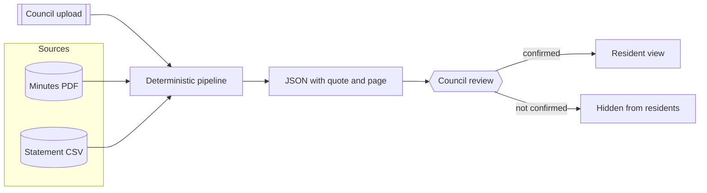

[Português](README.md) | [English](README.en.md)

# Painel do condomínio

Management shows, on one screen, what the assembly decided, what work is underway, and what has already been spent on that project.

An AI product case: how to link the minutes, the work, and the spend, with the council in the loop, on top of the app the condo already uses.

Author: Renan R. Rosa, Staff Product Manager. https://www.linkedin.com/in/renanrrosa

Status: in progress. Data is 100% fictional.

Series: [A CONFIRMAR]


The case is dated October 2026 and has not been piloted. The demo uses a fictional condo, Residencial das Acácias, and an illustrative 2027 calendar, so the March assembly has already happened and the garage painting is on step 2 of 4. That is a scenario, not a result.

The product name stays in Portuguese. The deeper notes in `docs/` are in Portuguese too.

## 1. Problem

Residents and the council cannot see the decision, the work, and the spend together. The minutes sit in a PDF, the work lives in chat, and the statement lumps generic lines ("repair materials", "labor for renovations") without saying which project they belong to.

- **The decision never becomes a task.** The vote exists, the quoted minutes exist, and still nobody sees an owner, a step, or a date.
- **Project spend disappears into a category.** A reader of the statement cannot tell how much of a line is the garage painting.
- **Common-area problems lose the thread.** In the condo that was observed, the occurrence log did not make the status clear, or whether a common-area problem stayed visible to everyone.
- **A change of manager erases the context.** The communication complaint that started this study still needs resident interviews. [A CONFIRMAR]

Product question: how can management show the path from the assembly decision to the work and the spend, without becoming a full-time help desk?

Why now: between assemblies, the legal duty to report the accounts is annual. Civil Code art. 1.348, VIII, requires the manager to report to the assembly, yearly and whenever asked. Art. 1.350 gives the annual assembly the budget and the accounts. In REsp 2.050.372/MT, the Superior Court of Justice held that a single unit owner does not demand the accounts alone: the manager reports to the assembly. In the gap, residents see what management chooses to show.

Market size is not a metric of this case. The 2025/2026 condo census, using IBGE, federal tax data, and uCondo, as cited by InfoMoney on 21 Dec 2025, counts 327,248 active condos, about 39 million residents, an average fee of R$ 516 in the first half of 2025, and delinquency over 30 days at 11.95%. Higher counts use a broader criterion. [A CONFIRMAR]

The app the studied condo already uses shows notices, assemblies with results, nested documents, scanned minutes without search, a statement by category and vendor, polls, and an occurrence log. It has no works module linking the vote, the execution, and the spend. uCondo's public pages describe a maintenance calendar with photos and tickets, plus assemblies with minutes. TownSq's public pages describe accounts, activities, maintenance, and a virtual assembly. This research did not find, on those pages, a resident view that joins decision, work, and spend. It may exist off the page. [A CONFIRMAR] Other management systems and digital condo accounts: [A CONFIRMAR]

The condo, the management company, and the app vendor are not named in this repository.

Fictional personas, not interviews: the resident who pays the fee and skips assemblies; the new manager who needs to show the work; the council member who compares the approved amount with the actual spend; the management company, which already runs the ERP and wants fewer repeated questions.


## 2. Solution

A layer on the current app, not a replacement. The screen chains three things:

1. **Decision:** the assembly vote, with the quoted minutes and the page.
2. **Work:** status, schedule, photos, owner.
3. **Spend:** statement lines tagged to that project, approved amount against actual.

Common-area problems and rule changes sit in the same view.

Demo screens: Home, Works, Decisions, Issues, Changes, and Questions. The interface itself is in Portuguese.

The fictional demo example is the garage painting: approved at the 18 March 2027 extraordinary assembly, up to R$ 45,000.00, step 2 of 4, R$ 18,000.00 already confirmed. A fourth, generic line stays out of the total until the council confirms it.

Flow:

1. **Trigger.** The council uploads the minutes PDF and the statement CSV. An API or export from the current app: [A CONFIRMAR]. Plan B is a manual upload.
2. **Read.** The pipeline reads the minutes pages and the statement lines.
3. **Output.** Decisions with quote and page, a suggested link from the expense to the work, and a monthly summary.
4. **Review.** The council confirms. Without confirmation, the item stays off the resident view.
5. **Delivery.** This panel. A WhatsApp channel: [A CONFIRMAR].

In a pilot, the AI layer would do four jobs: extract decisions from scanned minutes with a citation, suggest the expense link, summarize the month, and answer with a source or refuse. The default mode of this demo is deterministic, with no API key, on a fixed minutes layout. It does not measure model accuracy. Optional model mode writes a raw file and does not publish on its own. Provider and OCR engine: [A CONFIRMAR].


The same journey in a vertical crop is `docs/assets/jornada-1080x1350.png`.

<picture>
  <source media="(prefers-color-scheme: dark)" srcset="docs/assets/mock-dashboard-dark-1600x1000.png">
  
</picture>

Light and dark themes. The base is gray, with a light haze. Color is reserved for status.

## 3. Architecture



If someone turns the model mode on, it writes a raw file beside the panel. The resident view still comes from the deterministic pipeline and the review files.

Principles:

- **Least privilege.** The pipeline reads the files the council uploaded. It does not write to the condo app and it does not pay anything.
- **Human in the loop.** Publishing depends on the `confirmada` column in `examples/revisao/`. If nobody confirms, the resident does not see the item.
- **Traceability.** A decision shows file, page, and quote. An expense shows the CSV, the document id, and the line. The quote has to exist on the page.
- **Do not invent.** No quote, no decision. No project term, no link for a generic line. No source, the question is refused.
- **Privacy by default.** CPF (Brazilian individual taxpayer id) and unit-level votes are masked in the output. An issue has no field for who filed it. See `docs/privacidade.md`.

## 4. Results

There is no pilot. The table has no before and after numbers because those numbers do not exist.

| Dimension | Before | After |
| --- | --- | --- |
| Decisions linked to a work item | not measured | not measured |
| Renovation expenses tagged to a project | not measured | not measured |
| Units with a visit in the month | not measured | not measured |
| Repeated questions to management | no baseline | not measured |
| Understanding survey | no survey | not measured |
| Minutes summarized within 7 days | not measured | not measured |
| Answers with a cited source | not measured in real use | not measured in real use |

### How to measure

There has been no pilot and no survey with residents or with the council. What exists today is the pipeline on fictional minutes and a fictional statement, covered by the tests in `tests/`.

- **Test base:** 2 fictional minutes (7 motions, 6 published and 1 waiting for review) and 12 fictional statement lines in 3 CSVs. One renovation line is left without a project on purpose.
- **Primary metric, once there is a pilot:** share of assembly decisions with a linked execution item, and share of renovation expenses tagged to a project.
- **Planned comparison:** today's path (minutes in a folder, spend on the statement, work status in chat) against the same decision followed on the chain. That comparison has not been run.
- **Other planned measures, all without a baseline:** units with at least one visit in the month; volume of repeated questions before and after; a short survey, scale 1 to 5, with the sentence "I understand what was decided, what work is underway, and what was spent"; works with approved and actual amounts updated in the month; minutes with a summary published within 7 days; answers with a source; answers marked wrong; attendance or votes at the assembly.
- **Limits:** fictional data, a controlled minutes layout, no OCR of a photo, no users, no model in the measurement. The tests check a verbatim quote, the sum of confirmed lines, and the absence of a CPF. They do not check real minutes.

## 5. Lessons learned

Lessons from the research so far, not from a pilot.

1. **The accounts are already on screen. The work is not.** The current app already shows the statement by category and vendor. The gap is the link to the decision and to the execution.
2. **No page and no quote, no publish.** A loose summary of the minutes is not enough. The item carries the sentence and the page, or it stays out.
3. **The manager's effort decides whether this lives.** If every step is typed by hand, the panel stops. The design pushes the work to an upload of the minutes and the statement, plus a short confirmation. API: [A CONFIRMAR].
4. **Unit-level votes are already a risk in the current app.** The poll that was observed can show which unit voted for what. This panel shows only the aggregate.

## 6. Risks and limits

- **LGPD** (Brazil's data protection law). Minutes and issues can carry names, unit numbers, and third-party data, including delinquency. The default is to mask, with a legal basis and a clear controller (the condo) and operator. Those roles, in a pilot, are [A CONFIRMAR]. This repository has no real personal data.
- **Unit-level votes.** The panel does not show which unit voted for what, even where the current app does. The demo puts that line in the minutes on purpose and strips it from the output. See `tests/test_privacidade.py`.
- **Third-party data.** Names of residents, workers, and invoices have to be masked before indexing. The demo does not include those records.
- **Political use.** The screen can become a weapon between administrations. The record stays on the quoted minutes and the ledger line, with review, and without a slogan from management.
- **Hallucination.** An answer without a source is a refusal. There is no legal interpretation. Deterministic mode does not call a model.
- **Adoption.** If the manager has to type everything, it dies. The API that would reduce that work is [A CONFIRMAR].
- **Dependency.** The management company or the current app may refuse an export.
- **Demo without a login.** The council view, here, is a toggle. Do not use that pattern with real documents.
- **What this case leaves out:** payments, Pix, apportionment, bills, the reserve fund, and Open Finance. That is a scope choice.

## 7. Next steps

1. A validation survey with the council and with residents, before treating the problem as settled.
2. A possible pilot, if the manager and the council agree. [A CONFIRMAR]
3. Find out whether the current app exports minutes, statements, and issues, and whether a works module is on its roadmap. [A CONFIRMAR]
4. Finish the reading of other management systems and digital condo accounts. [A CONFIRMAR]
5. Decide who pays for the layer. [A CONFIRMAR]
6. Choose an OCR engine and, if model mode is used, the provider. [A CONFIRMAR]
7. Decide whether WhatsApp is a channel for questions and issues, and at what priority. [A CONFIRMAR]
8. A public statistic on dissatisfaction with management communication: not found in this round. [A CONFIRMAR]

## How to run

Demo mode, no credentials:

```bash
python demo.py
```

Serves http://127.0.0.1:8765 from the files in `examples/`. Python 3.11 or newer. The standard library only. The screens are in Portuguese.

Tests:

```bash
python -m unittest discover -s tests -v
```

Generate the output without the server:

```bash
python demo.py --no-serve
```

With real data: see `docs/como-replicar.md`. Copy `.env.example` to `.env` only if you use the optional model mode. The demo reads no API key.

## Repository structure

| Path | What it is |
| --- | --- |
| `docs/` | Decisions, privacy, and how to replicate |
| `docs/assets/` | Figures used above. `capa-repo-1280x640.png` is the image for the repository social preview. It is not embedded in the body of this page |
| `prompts/` | Versioned prompts for the optional model mode |
| `src/` | Pipeline, questions, and the demo server |
| `template/` | JSON schema for a decision, an expense, and the summary |
| `examples/` | Fictional minutes, statement, and registers, plus generated `saida/` |
| `tests/` | Tests, including the check for personal data and CPF |

## Sources

- InfoMoney, 2025/2026 condo census, 21 Dec 2025: https://www.infomoney.com.br/economia/condominios-ficam-mais-caros-e-inadimplencia-avanca-mostra-pesquisa/
- Civil Code, Law 10.406/2002, arts. 1.348 and 1.350: https://www.planalto.gov.br/ccivil_03/leis/2002/l10406compilada.htm
- Superior Court of Justice, REsp 2.050.372/MT: https://www.lexml.gov.br/urn/urn:lex:superior.tribunal.justica;turma.3:acordao;resp:2023-04-25;2050372-2282683
- uCondo, management and communication: https://www.ucondo.com.br/gestao/ucondo-gestao-de-condominios-inteligente-com-o-ucondo and https://www.ucondo.com.br/solucoes/comunicacao-organizada-no-condominio
- TownSq, plans and management: https://townsq.com.br/planos/ and https://townsq.com.br/gestao-de-condominios/
- Resident access to documents, background reading: https://www.sindiconet.com.br/informese/acesso-documentos-condominio-para-moradores-documentacao and https://sipces.org.br/artigo.php?id=19126

## Notice

A personal, educational project, with no tie to employers or to the vendors named here. Every data point in the repository is fictional. Nothing here is financial, credit, or investment advice, and nothing here is legal advice. MIT license.
