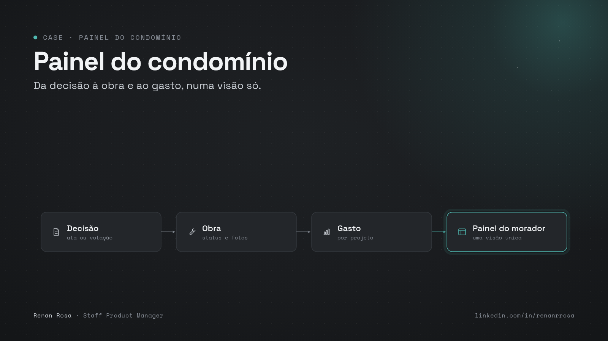
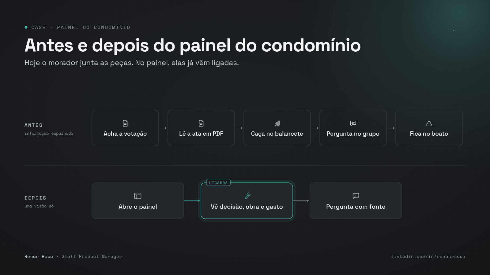
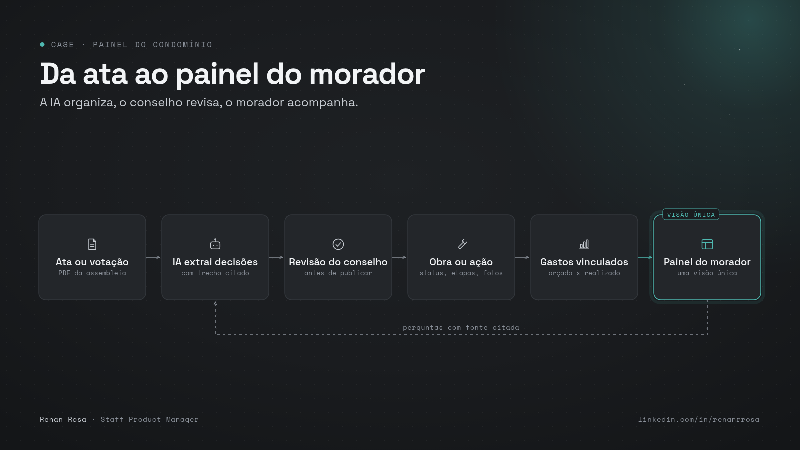
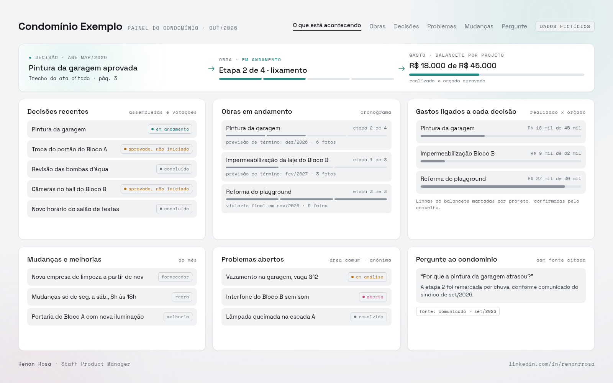
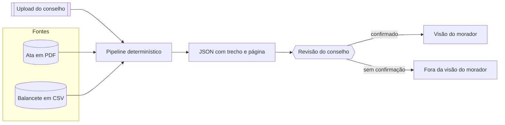

[Português](README.md) | [English](README.en.md)

# Painel do condomínio

A gestão mostra, numa tela só, o que a assembleia decidiu, o que está em obra e o que já foi gasto naquele projeto.

Um case de produto de IA: como ligar a ata, a obra e o gasto, com o conselho no circuito, por cima do aplicativo que o condomínio já usa.

Autor: Renan R. Rosa, Staff Product Manager. https://www.linkedin.com/in/renanrrosa

Status: em andamento. Dados 100% fictícios.

Série: [A CONFIRMAR]



O case está em outubro de 2026 e ainda não teve piloto. A demo usa o condomínio fictício Residencial das Acácias e um calendário ilustrativo de 2027, para a assembleia de março já ter acontecido e a pintura da garagem estar na etapa 2 de 4. Isso é cenário, não resultado.

## 1. Problema

O morador e o conselho não veem juntos a decisão, a obra e o gasto. A ata fica num PDF, a obra corre em conversa, e o balancete junta linhas genéricas ("material para reformas e reparos", "mão de obra em reformas") sem dizer a qual projeto pertencem.

- **A decisão não vira tarefa.** A votação existe, o trecho da ata existe, e mesmo assim ninguém vê dono, etapa ou prazo.
- **O gasto da obra se perde na categoria.** Quem lê o balancete não sabe quanto daquela linha é a pintura da garagem.
- **O problema de área comum perde o fio.** No condomínio observado, o livro de ocorrências não deixava claro o andamento, nem se o problema da área comum ficava visível para todos.
- **Troca de síndico apaga o contexto.** A queixa de comunicação que motivou o estudo ainda depende de entrevista com moradores. [A CONFIRMAR]

Pergunta de produto: como a gestão mostra o caminho entre a decisão da assembleia, a obra e o gasto, sem virar atendente o dia inteiro?

Por que agora: entre uma assembleia e outra, a prestação de contas legal é anual. O Código Civil, art. 1.348, VIII, manda o síndico prestar contas à assembleia, anualmente e quando exigidas. O art. 1.350 dá à assembleia anual o orçamento e as contas. No REsp 2.050.372/MT, o STJ entendeu que o condômino não exige as contas sozinho: o síndico presta contas à assembleia. No intervalo, o morador vê o que a gestão escolhe mostrar.

O tamanho do mercado não é métrica deste case. O Censo Condominial 2025/2026, com IBGE, Receita Federal e uCondo, citado pela InfoMoney em 21/12/2025, conta 327.248 condomínios ativos, cerca de 39 milhões de moradores, taxa média de R$ 516 no primeiro semestre de 2025 e inadimplência acima de 30 dias em 11,95%. Há contagens mais altas, com outro critério. [A CONFIRMAR]

O aplicativo que o condomínio estudado já usa mostra comunicado, assembleia com resultado, documento em pasta, ata escaneada sem busca, balancete por categoria e fornecedor, enquete e livro de ocorrências. Não há módulo de obras ligando votação, execução e gasto. Nas páginas públicas da uCondo há agenda de manutenção com foto e chamado, e assembleia com ata. Na TownSq há contas, atividades, manutenção e assembleia virtual. Nesta pesquisa não apareceu, nessas páginas, uma visão do morador que una decisão, obra e gasto. Pode existir fora da página. [A CONFIRMAR] Outros sistemas de administradora e conta digital: [A CONFIRMAR]

Nome do condomínio, da administradora e do fornecedor do aplicativo ficam de fora deste repositório.

Personas fictícias, não entrevistas: a moradora que paga a taxa e não vai à assembleia; o síndico novo, que precisa mostrar o trabalho; a conselheira, que compara o valor aprovado com o realizado; a administradora, que já opera o ERP e quer menos pergunta repetida.



## 2. Solução

Uma camada sobre o aplicativo atual, não um substituto. A tela encadeia três coisas:

1. **Decisão:** votação da assembleia, com o trecho da ata e a página.
2. **Obra:** status, cronograma, fotos, responsável.
3. **Gasto:** linhas do balancete marcadas naquele projeto, com o aprovado e o realizado.

Ocorrência de área comum e mudança de regra entram na mesma visão.

Telas da demo: Início, Obras, Decisões, Ocorrências, Mudanças e Perguntas.

O exemplo fictício da demo é a pintura da garagem: aprovada na AGE de 18 de março de 2027, até R$ 45.000,00, etapa 2 de 4, R$ 18.000,00 já confirmados. Um quarto lançamento, genérico, fica de fora da soma até o conselho confirmar.

Fluxo:

1. **Gatilho.** O conselho sobe a ata em PDF e o balancete em CSV. API ou exportação do aplicativo atual: [A CONFIRMAR]. O plano B é o upload manual.
2. **Leitura.** O pipeline lê as páginas da ata e as linhas do balancete.
3. **Saída.** Decisões com trecho e página, sugestão de vínculo do gasto, resumo do mês.
4. **Revisão.** O conselho confirma. Sem confirmação, o item não entra na visão do morador.
5. **Entrega.** Este painel. Canal de WhatsApp: [A CONFIRMAR].

A camada de IA, num piloto, faria quatro trabalhos: extrair a decisão da ata escaneada com citação, sugerir o vínculo do gasto, resumir o mês e responder com fonte ou recusar. O modo padrão desta demo é determinístico, sem chave, num layout fixo de ata. Ele não mede acerto de modelo. O modo com modelo é opcional, grava um texto bruto e não publica sozinho. Fornecedor e motor de OCR: [A CONFIRMAR].



A mesma jornada em formato vertical está em `docs/assets/jornada-1080x1350.png`.

<picture>
  <source media="(prefers-color-scheme: dark)" srcset="docs/assets/mock-dashboard-dark-1600x1000.png">
  
</picture>

Tema claro e tema escuro. A base é cinza, com uma névoa leve. A cor fica no status.

## 3. Arquitetura



O modo com modelo, se alguém ligar, escreve um arquivo bruto ao lado. A visão do morador continua saindo do pipeline determinístico e da revisão.

Princípios:

- **Permissão mínima.** O pipeline lê os arquivos que o conselho subiu. Não escreve no aplicativo do condomínio e não paga nada.
- **Humano no circuito.** A publicação depende da coluna `confirmada` em `examples/revisao/`. Se ninguém confirma, o morador não vê o item.
- **Rastreabilidade.** Decisão mostra arquivo, página e trecho. Gasto mostra CSV, documento e linha. O trecho tem de existir na página.
- **Nunca inventar.** Sem trecho, a decisão não sai. Sem termo de projeto, a linha genérica não ganha obra. Sem fonte, a pergunta é recusada.
- **Privacidade por padrão.** CPF e voto de unidade são mascarados na saída. Ocorrência não tem campo de quem registrou. Ver `docs/privacidade.md`.

## 4. Resultados

Não há piloto. A tabela não tem número de antes e depois porque esse número não existe.

| Dimensão | Antes | Depois |
| --- | --- | --- |
| Decisões com obra vinculada | sem medição | sem medição |
| Despesas de reforma com projeto | sem medição | sem medição |
| Unidades com acesso no mês | sem medição | sem medição |
| Perguntas repetidas à gestão | sem baseline | sem medição |
| Pesquisa de entendimento | sem pesquisa | sem medição |
| Atas com resumo em até 7 dias | sem medição | sem medição |
| Respostas com fonte citada | sem medição em uso real | sem medição em uso real |

### Como medir

Ainda não houve piloto nem pesquisa com moradores ou com o conselho. O que existe hoje é o pipeline em cima de ata e balancete fictícios, coberto pelos testes em `tests/`.

- **Base de teste:** 2 atas fictícias (7 deliberações, 6 publicadas e 1 em revisão) e 12 lançamentos fictícios em 3 CSVs. Um dos lançamentos de reforma fica sem obra de propósito.
- **Métrica principal, quando houver piloto:** parcela das decisões de assembleia com item de execução vinculado, e parcela das despesas de reforma marcadas a um projeto.
- **Comparação prevista:** o caminho de hoje (ata numa pasta, gasto no balancete, status da obra na conversa) contra a mesma decisão acompanhada na cadeia. Essa comparação não foi feita.
- **Outras medidas previstas, todas sem baseline:** unidades com ao menos um acesso no mês; volume de perguntas repetidas antes e depois; pesquisa curta, escala de 1 a 5, com a frase "entendo o que foi decidido, o que está em obra e o que foi gasto"; obras com aprovado e realizado atualizados no mês; atas com resumo publicado em até 7 dias; respostas com fonte; respostas marcadas como erradas; presença ou voto em assembleia.
- **Limitações:** dado fictício, layout de ata controlado, sem OCR de imagem, sem usuário, sem modelo na medida. Os testes checam citação literal, soma dos lançamentos confirmados e ausência de CPF. Não checam ata real.

## 5. Lições aprendidas

Lições da pesquisa até aqui, não de um piloto.

1. **A conta já aparece. A obra, não.** O aplicativo atual já mostra o balancete com categoria e fornecedor. O buraco é a ligação com a decisão e com a execução.
2. **Sem página e sem trecho, não publica.** Um resumo solto da ata não serve. O item carrega a frase e a página, ou fica de fora.
3. **O esforço do síndico decide se isso vive.** Se a entrada for digitação manual de cada etapa, o painel para. O desenho empurra o trabalho para upload da ata e do balancete, e para uma confirmação curta. API: [A CONFIRMAR].
4. **Voto por unidade já é um risco no aplicativo atual.** A enquete observada deixa ver qual unidade votou em quê. Este painel mostra só o agregado.

## 6. Riscos e limites

- **LGPD.** Ata e ocorrência podem trazer nome, unidade e dado de terceiro, inclusive inadimplência. O padrão é mascarar, com base legal, controlador (o condomínio) e operador definidos. Esses papéis, num piloto, são [A CONFIRMAR]. Este repositório não tem dado real.
- **Voto por unidade.** O painel não mostra qual unidade votou em quê, mesmo que o aplicativo atual mostre. A demo traz essa linha na ata de propósito e a tira da saída. Ver o teste em `tests/test_privacidade.py`.
- **Dado de terceiro.** Nome de morador, de funcionário e de nota fiscal precisa ser mascarado antes de indexar. A demo não contém esses cadastros.
- **Uso político.** A tela pode virar arma entre gestões. O registro fica no trecho da ata e no lançamento, com revisão, sem adjetivo da gestão.
- **Alucinação.** Resposta sem fonte é recusa. Não há interpretação jurídica. O modo determinístico não chama modelo.
- **Adoção.** Se depender de o síndico preencher tudo à mão, morre. A API que reduziria esse trabalho é [A CONFIRMAR].
- **Dependência.** A administradora ou o aplicativo atual podem negar exportação.
- **Demo sem login.** A visão do conselho, aqui, é um botão. Não usar esse padrão com documento real.
- **O que este case deixa de fora:** pagamento, Pix, rateio, boleto, fundo de reserva e Open Finance. A escolha é de escopo.

## 7. Próximos passos

1. Pesquisa de validação com o conselho e com os moradores, antes de tratar o problema como fechado.
2. Possível piloto, se o síndico e o conselho aceitarem. [A CONFIRMAR]
3. Saber se o aplicativo atual exporta ata, balancete e ocorrência, e se há módulo de obras no roadmap. [A CONFIRMAR]
4. Completar a leitura de outros sistemas de administradora e de conta digital. [A CONFIRMAR]
5. Definir quem paga a camada. [A CONFIRMAR]
6. Escolher motor de OCR e, se o modo com modelo entrar, o fornecedor. [A CONFIRMAR]
7. Decidir se WhatsApp é canal de pergunta e de ocorrência, e com qual prioridade. [A CONFIRMAR]
8. Estatística pública sobre insatisfação com a comunicação da gestão: não encontrada nesta rodada. [A CONFIRMAR]

## Como rodar

Modo demo, sem credencial:

```bash
python demo.py
```

Sobe em http://127.0.0.1:8765 com os arquivos de `examples/`. Python 3.11 ou mais novo. Só a biblioteca padrão.

Testes:

```bash
python -m unittest discover -s tests -v
```

Só gerar a saída, sem servidor:

```bash
python demo.py --no-serve
```

Com dado real: veja `docs/como-replicar.md`. Copie `.env.example` para `.env` só se for usar o modo opcional com modelo. A demo não lê chave nenhuma.

## Estrutura do repositório

| Caminho | O que é |
| --- | --- |
| `docs/` | Decisões, privacidade e como replicar |
| `docs/assets/` | Figuras do README. `capa-repo-1280x640.png` é a imagem da social preview do repositório, não entra no corpo desta página |
| `prompts/` | Prompts versionados do modo opcional |
| `src/` | Pipeline, perguntas e o servidor da demo |
| `template/` | Esquema JSON da decisão, da despesa e do resumo |
| `examples/` | Ata, balancete e registros fictícios, mais `saida/` gerada |
| `tests/` | Testes, inclusive a checagem de dado pessoal e de CPF |

## Fontes

- InfoMoney, Censo Condominial 2025/2026, 21/12/2025: https://www.infomoney.com.br/economia/condominios-ficam-mais-caros-e-inadimplencia-avanca-mostra-pesquisa/
- Código Civil, Lei 10.406/2002, arts. 1.348 e 1.350: https://www.planalto.gov.br/ccivil_03/leis/2002/l10406compilada.htm
- STJ, REsp 2.050.372/MT: https://www.lexml.gov.br/urn/urn:lex:superior.tribunal.justica;turma.3:acordao;resp:2023-04-25;2050372-2282683
- uCondo, gestão e comunicação: https://www.ucondo.com.br/gestao/ucondo-gestao-de-condominios-inteligente-com-o-ucondo e https://www.ucondo.com.br/solucoes/comunicacao-organizada-no-condominio
- TownSq, planos e gestão: https://townsq.com.br/planos/ e https://townsq.com.br/gestao-de-condominios/
- Acesso do morador a documentos, leitura de apoio: https://www.sindiconet.com.br/informese/acesso-documentos-condominio-para-moradores-documentacao e https://sipces.org.br/artigo.php?id=19126

## Aviso

Projeto pessoal e educativo, sem vínculo com empregadores ou com os fornecedores citados. Todos os dados do repositório são fictícios. Nada aqui é recomendação financeira, de crédito, de investimento, nem orientação jurídica. Licença MIT.
